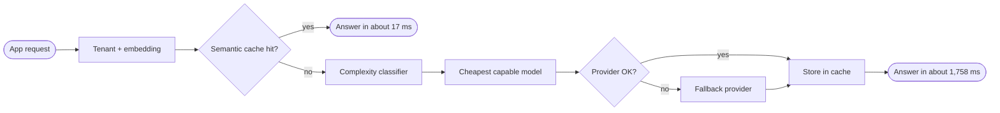

<p align="center">
  
</p>

<p align="center">
  <a href="https://git.io/typing-svg">
    
  </a>
</p>

<p align="center">
  <a href="https://www.linkedin.com/in/akhilesh-kovelakuntla-09a488265"></a>
  <a href="mailto:akhileshkovelakuntla@gmail.com"></a>
  <a href="https://leetcode.com/u/akhileshkovelakuntla/"></a>
  <a href="https://medium.com/@akhileshkovelakuntla"></a>
  <a href="https://twitter.com/akhilbuildzx"></a>
</p>

---

## `whoami`

```python
class Akhilesh:
    name       = "Akhilesh Kovelakuntla"
    role       = "AI & Backend Engineering Intern @ Merlin"
    education  = "B.Tech CSE, IIIT RK Valley, 2027"
    focus      = ["LLM infrastructure", "Voice AI", "Backend APIs", "RAG"]
    stack      = "Python, FastAPI, Redis, PostgreSQL, Docker"
    building   = "Synapse CLI (PyPI package, in development)"
    open_source = "Pydantic AI"

    def approach(self, problem):
        self.make_it_exist(problem)     # get a working version first
        self.test_each_step(problem)    # test every stage of the pipeline on its own
        self.wire_it_together(problem)  # connect the stages, then improve the whole
        return "let's get things right"

    motto = "Make it exist, then make it good."
```

---

## What I Build

<table>
<tr>
<td width="33%" valign="top">

### LLM Infrastructure
Semantic caching, cost-aware routing across providers, and fallbacks. I move models to lighter runtimes when size and memory become a problem.

</td>
<td width="33%" valign="top">

### Real-time Voice AI
Voice activity detection, streaming speech-to-text, TTS and fallback paths. Built for low latency, since a person is waiting on the other end.

</td>
<td width="33%" valign="top">

### Backend APIs
End-to-end API design with sessions, auth, cancellation and ordered audio transport. Monitored with Prometheus, Grafana and Sentry.

</td>
</tr>
<tr>
<td width="33%" valign="top">

### RAG and Agents
Qdrant-backed memory for a voice agent, and a multi-agent platform with 5 agents that adapt course material to a learner.

</td>
<td width="33%" valign="top">

### Applied ML
A multilingual scam detector (English, Telugu, Hindi) with a 2-layer DistilBERT and BERT classifier at 94% F1.

</td>
<td width="33%" valign="top">

### Open Source and Tools
Credited fix merged in Pydantic AI, an open MCP PR for `clai web`, and Synapse CLI, a developer tool I'm building.

</td>
</tr>
</table>

---

## How the LLM Gateway Works



I built the first router as a rule-based classifier, replaced it with a small neural network, and then moved inference from PyTorch to ONNX Runtime. That cut memory by 44% and image size by 58%.

**How I work**
- **Make it exist first.** A rough working version teaches more than a perfect plan.
- **Test each step alone.** I check every stage of a pipeline by itself, improve it, and only then wire the stages together.
- **Measure latency early.** In the voice work, I time every stage before I try to speed anything up.
- **Don't trust one provider.** Fallbacks and circuit breakers go in from the start.

---

## Currently Building

**Synapse CLI** is a Python package for developers, still in development. It turns natural language requests into commands a machine can run, then executes them based on how risky each command is.

## Next on My List

Learning one major cloud platform and getting into forward deployed engineering. I haven't started yet, but it's what I'm heading toward.

---

## Selected Projects

| Project | What it does |
|---|---|
| [LLM Gateway](https://github.com/Akhilesh0605/LLM_GATEWAY) | Multi-tenant gateway across 5 providers. Semantic cache brings repeat queries from about 1,758 ms to about 17 ms. |
| [AI Meeting Representative](https://github.com/Akhilesh0605/AI-Meeting-Representative) | Voice agent for Google Meet. 2-container design, 1 to 2 s latency, Qdrant memory. |
| [Rakshana AI](https://github.com/Akhilesh0605/AAdhya-Backend) | Scam detection app. 94% F1, OCR cut from 22 s to under 2 s. Won the Aadhya hackathon. |
| [AI E-Learning Platform](https://github.com/Akhilesh0605/AI_E-Learning-Platform) | 5 agents that generate full course material in under 8 s. |

---

## Toolbox

**Languages and Backend**
<br/>

<br/>


**LLM and AI**
<br/>


**Monitoring**
<br/>


---

<p align="center">
  <b>Ask me about:</b> LLM caching and routing, voice pipelines, backend APIs, Pydantic AI. &nbsp;·&nbsp;
  <b>Open to:</b> internships and full-time roles where I can learn fast and ship.
</p>

<p align="center">
  
</p>
